# Single-cell RNA-seq of Alzheimer’s disease olfactory mucosa

This project analyzes two 10x single-cell libraries labelled `AD1` and `Control2`. It covers basic quality control, clustering, cluster marker genes, and a small check of genes reported in a recent olfactory Alzheimer’s study.

## Data and limits

The local matrices contain one AD sample and one control sample. After filtering, the analysis retains **2,003 AD1 cells** and **1,715 Control2 cells** (**3,718 total**). Cells from one person are not independent biological replicates. This dataset can show cell-level patterns, but it cannot support a reliable disease-level differential-expression test or biomarker claim.

The source accession and sample metadata are not included in this repository. The count matrices, archives, and other input data are excluded from Git. See [data/README.md](data/README.md) for how to run the scripts with local files.

## Methods

| Step | Method and settings |
| --- | --- |
| Input | 10x `Read10X`; `CreateSeuratObject(min.cells = 3, min.features = 100)` |
| QC metrics | Mitochondrial `^MT-`; ribosomal `^RP[SL]`; hemoglobin `^HB[^(P)]` |
| Cell filters | `200 < nFeature_RNA < 5,000`; mitochondrial fraction `< 10%` |
| Normalize | Seurat `LogNormalize`, scale factor `10,000` |
| Variable genes | `vst`, 2,000 genes; scale variable genes |
| PCA and UMAP | 40 PCs calculated; dimensions 1–25 used for UMAP and neighbors |
| Clustering | Seurat graph clustering at resolutions 0.1–0.8; compare with `clustree`; display resolution 0.8 |
| Cluster markers | `FindAllMarkers`, Wilcoxon test, `min.pct = 0.25`, positive markers, adjusted p < 0.05 |

The cluster marker table describes differences between clusters in this dataset. It does not identify disease biomarkers. The condition-level `FindMarkers` tests from the earlier script were removed because one sample per group cannot provide biological replication; treating thousands of cells as independent patients would overstate evidence.

## Results

- The provided QC results retain 3,718 cells across the two libraries.
- The earlier clustering produced 10 groups at resolution 0.8. The marker genes can help with follow-up cell annotation, but cell identities need to be checked against marker evidence before being reported.
- The original plots show QC distributions, PCA, UMAP, and cluster stability across resolutions.

### QC and expression figures

| AD1 | Control2 |
| --- | --- |
| 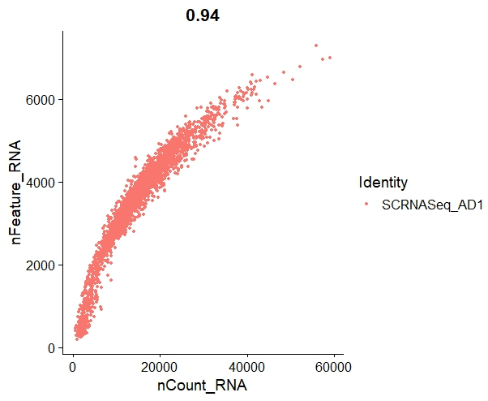 | 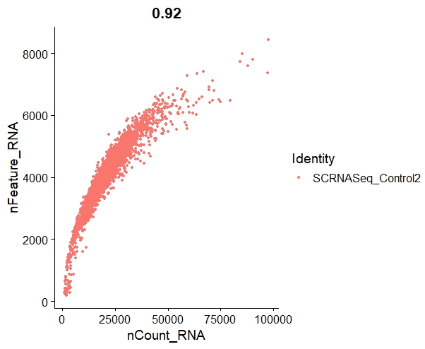 |
| 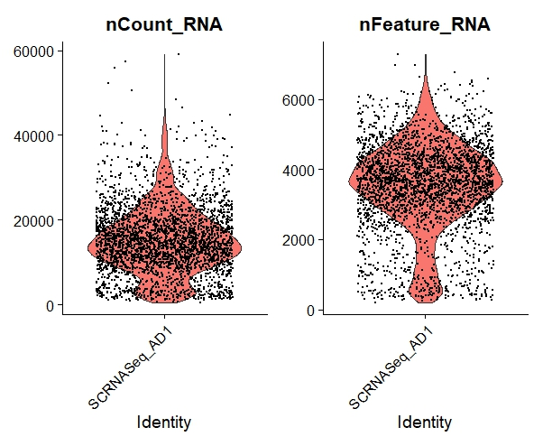 | 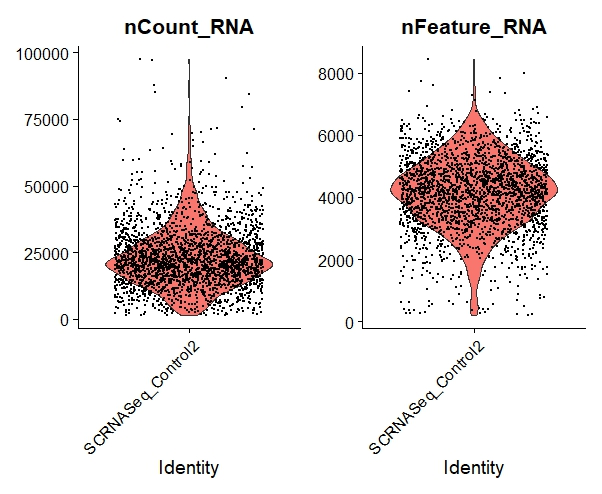 |
| 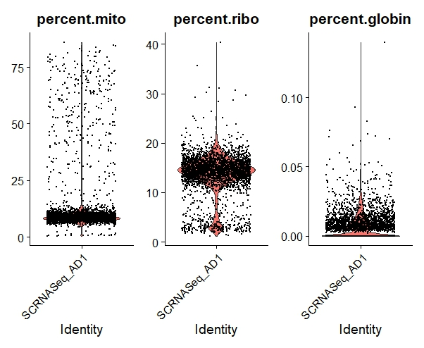 | 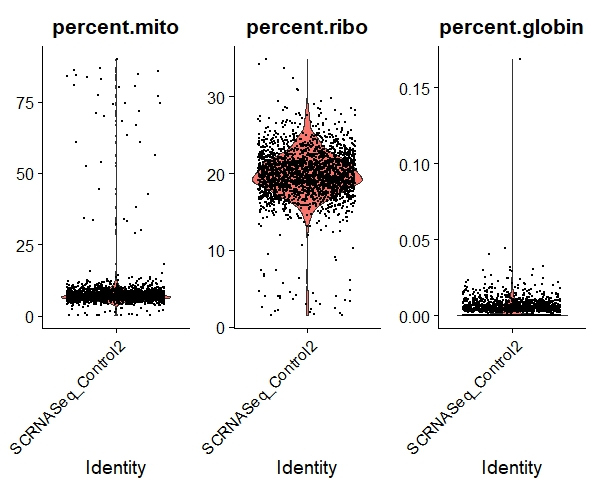 |
| 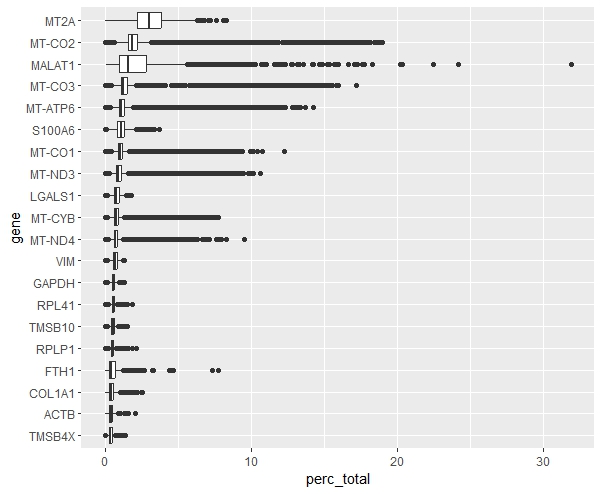 | 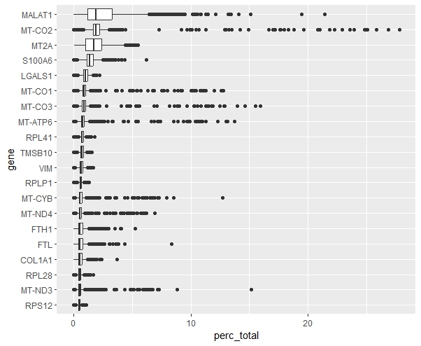 |

### Variable genes and dimensionality reduction

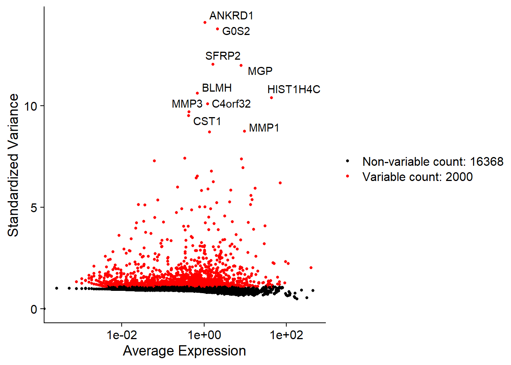

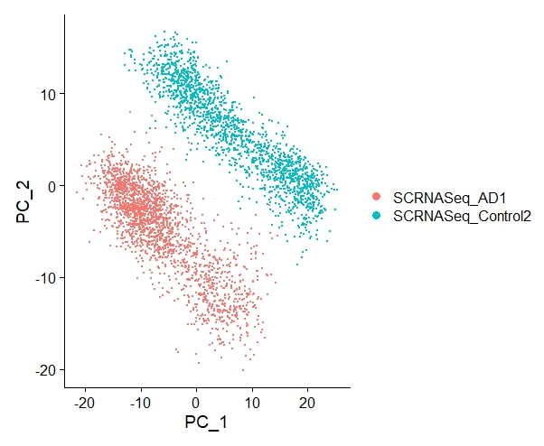

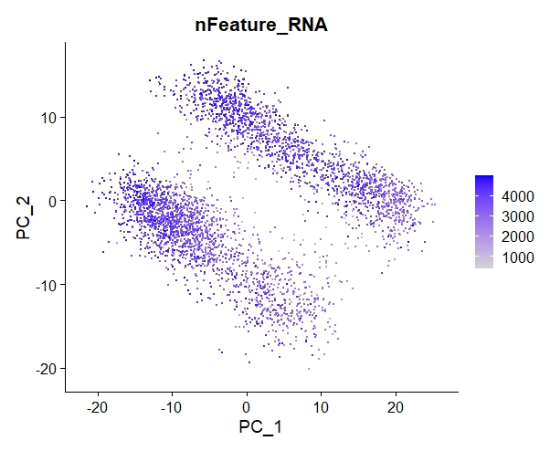

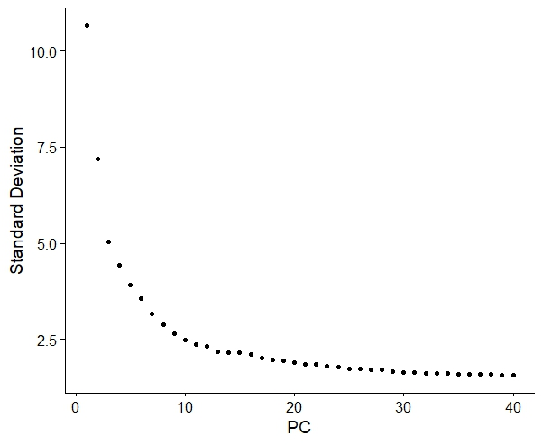

### UMAP and clusters

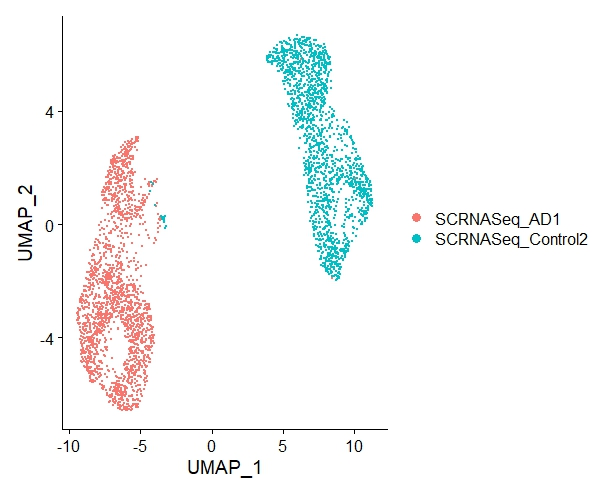

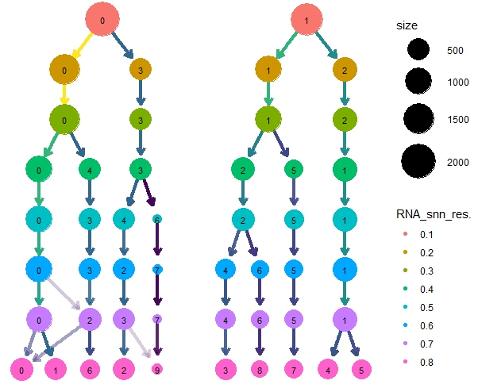

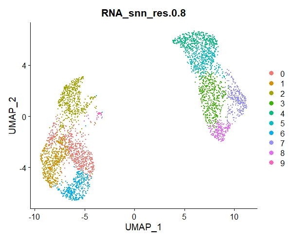

## Added analysis: genes from a recent olfactory AD study

I checked expression of seven genes highlighted in a recent study of olfactory epithelium from **22 donors**: six controls, nine people with preclinical AD, and seven with clinical AD. That study reported cell-type-specific changes in olfactory sensory neurons and myeloid cells ([D’Anniballe et al., 2026](https://www.nature.com/articles/s41467-026-70099-7); public data: [GEO GSE302937](https://www.ncbi.nlm.nih.gov/geo/query/acc.cgi?acc=GSE302937)).

In the local data, `AKR1B1` was detected in 75.5% of AD1 cells and 85.7% of Control2 cells; `LBH` in 14.2% and 15.7%; `EGR3` in 2.1% and 1.3%; and `MIF` in 92.2% and 98.2%. `CERT1`, `HLA-DQA2`, and `GZMA` were absent from the filtered feature matrix. These are descriptive percentages across all cells, not cell-type-specific tests or evidence of an AD effect.

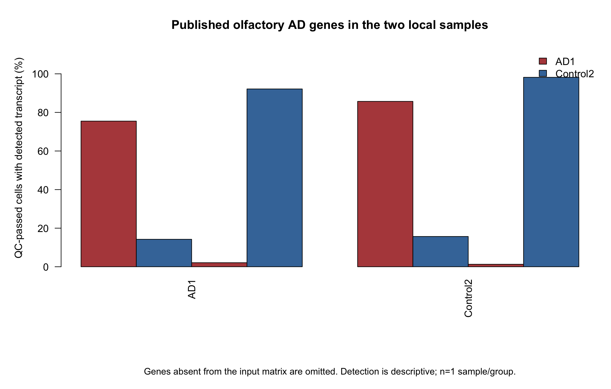

The newer cohort is a useful next step for a stronger replication: analyze its donor-level counts with pseudobulk methods, then compare cell-type-specific results. Do not combine cell counts across donors as if they were independent participants.

## Run the analysis

Install R packages `Seurat`, `ggplot2`, `clustree`, and `Matrix`. Place the 10x folders at `data/AD1/` and `data/Control2/`, or point `DATA_DIR` to a folder containing both. Do not commit the data files.

```bash
Rscript scRNAseq_Alzheimers_Olfactory_Mucosa.R
Rscript external_signature_screen.R
```

The first script writes QC summaries, exploratory cluster markers, and current PCA/UMAP/clustree figures under `results/`. The second writes `results/external_signature_screen.csv` and the figure shown above. Both scripts use one sample per condition and therefore do not calculate condition-level significance.

## Files

- `scRNAseq_Alzheimers_Olfactory_Mucosa.R` — portable Seurat workflow.
- `external_signature_screen.R` — descriptive screen of selected genes from the 2026 olfactory AD study.
- `figures/` — figures from the original analysis.
- `results/` — added gene screen and outputs generated by the Seurat workflow.
- `data/README.md` — local input instructions.
